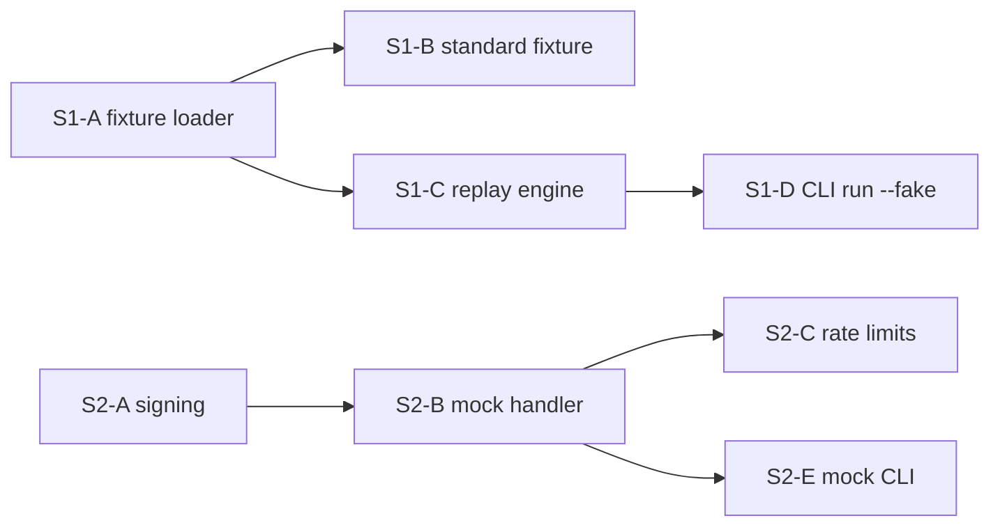

# US-S1-01 breakdown: Fake Source and Mock Margince harness

Parent story: **US-S1-01, Deterministic Fake Source & Mock Margince Testing Harness** (Feature S-1, Must). The parent never runs in the factory; only its sub-tasks do. Each sub-task is one file in this folder, written to `factory/docs/spec-standard.md` and checked with `t12-adapter spec-check --forge asana`.

## What is already done (on `fix/tier-timing`)

The factory refuses a product that has no test tier and no committed verify skill, and it cannot write a test against a contract it has not seen. Two prerequisites were therefore done by a person, not by the factory, and are committed on this branch:

| # | Prerequisite | What is there | Where |
|---|---|---|---|
| P0a | **ChatBridge skeleton** | Node 22.18+ and TypeScript package with Vitest, `tsc --noEmit` and ESLint; `main(argv, io)` with usage and exit codes 0/1/2; `Io` (stdout, stderr, readFile, clock, env, listen), the test helper `testIo`, and the **real** wiring of every `Io` field in `bin.ts`; the `chat-bridge` bin; the `chatbridge` product in `.t12/project.json`; the verify skill | `chatbridge/`, `.t12/project.json`, `chatbridge/.claude/skills/verify/` |
| P0b | **Margince contract (stand-in)** | `signing.md`, `vectors.json` (5 vectors), `pairs/*.json` (15 recorded cases, each with its secret and the requests that came before it) and `generate.mjs` | `chatbridge/contract/margince/` |

**P0b is a stand-in.** Tam Vu's Margince PR is not available. The contract is written from US-13, the meeting log (Margince answers `202` only) and TC-048/049; every other rule is marked *Decided here* in `signing.md`. "Identical responses to Margince" in this story therefore means identical to that folder. Real parity (the mock against a Margince built from Tam Vu's PR) is a follow-up for a person: replace the *Decided here* rules, change `generate.mjs`, regenerate.

Stack (Node + TypeScript) is an assumption from the backlog: Zalo is reached through `zca-js`, which only exists for Node. Change P0a and every `Touches:` line if the team picks another stack.

### The profile

`.t12/project.json` (excerpt; `engineer` is deliberately not set, the benchmark sets the mode per task):

```json
"chatbridge": {
  "paths": ["chatbridge/**"],
  "test_report": "vitest-json",
  "tiers": {"unit": {
    "command": ["/home/thearesia/.local/share/mise/installs/node/26.13.1/bin/node", "chatbridge/node_modules/vitest/vitest.mjs",
                "run", "--root", "chatbridge", "--reporter=json", "--outputFile=/dev/stdout", "--configLoader", "runner"],
    "globs": ["chatbridge/src/**/*.test.ts"]}},
  "static": [
    {"name": "typecheck", "command": ["<node>", "chatbridge/node_modules/typescript/bin/tsc", "--noEmit", "-p", "chatbridge/tsconfig.json"]},
    {"name": "eslint", "command": ["<node>", "chatbridge/node_modules/eslint/bin/eslint.js", "--config", "chatbridge/eslint.config.js", "chatbridge"]}
  ]
}
"verify_deps": ["chatbridge/node_modules"],
"protected_paths": ["chatbridge/contract/margince"],
```

- **No `test_build_command`.** There is no compile step: Vitest transpiles on the fly and `tsc` is a static check, so nothing needs building before the timed run.
- **Absolute node in every argv, `vitest-json` with the reporter flags written out.** Under Landlock a version-manager shim does not run, and the core only recognises a command whose first word is `vitest`; ours starts with node, so it asks for the JSON report itself (`--reporter=json --outputFile=/dev/stdout`), which `test_report: vitest-json` then reads. `--configLoader runner` and the cache paths in `vitest.config.ts` keep Vitest from writing into the read-only `node_modules`. Proved for both engineer modes in a temporary state home: deep final and static checks, tdd red and green.
- **`protected_paths` names `chatbridge/contract/margince`, not `chatbridge/contract`.** A `verify_deps` entry may not sit in the folder of a protected path, and `chatbridge/node_modules` sits in `chatbridge/`; a protected path one level deeper leaves that folder alone.
- **`verify_deps` is repo-wide.** A task of the `factory` product that runs in this repo has to narrow it (`"verify_deps": []` in its task file) or the run looks for `chatbridge/node_modules` in its worktree.

### Environment for a run

- `T12_TOOLCHAIN_DIRS=/home/thearesia/.local/share/mise/installs/node/26.13.1` in the environment of `t12` and the runner (the node install dir, not a shim and not `$HOME`). Another machine changes this value and the node path in the three argv above.
- Three things the factory does not do for a Node product, so the operator does them for each task: (1) `prepare` times the unit tier on a bare checkout of the base commit that has no `node_modules`, so it prints `warning: the unit tier exited 1 on the base commit` and succeeds; (2) after `prepare`, `chatbridge/node_modules` is copied into the task's worktree (`cp -r chatbridge/node_modules <home>/worktrees/<task>/chatbridge/`; it must be a real directory, a symlink out of the worktree is refused) before any role runs, or red, final and static fail with module not found; (3) `chatbridge/node_modules` comes from `cd chatbridge && npm ci`.
- The base commit of every sub-task must contain P0a and P0b: file the nine only once this branch is on the trunk the state home follows. Do not tag S2-A `factory` before P0b is there.

## Sub-tasks and order



| Id | Title | Criteria | `Depends on:` |
|---|---|---|---|
| S1-A | Load a Fake Source fixture file | 6 | none |
| S1-B | Standard fixture covering every message kind | 5 | S1-A |
| S1-C | Replay fixture events at a configured speed | 6 | S1-A |
| S1-D | `chat-bridge run --fake <fixture>` | 6 | S1-C |
| S2-A | Sign and verify Margince requests | 5 | none |
| S2-B | Mock Margince validates signed batches | 8 | S2-A |
| S2-C | Mock Margince enforces Margince's rate limits | 5 | S2-B |
| S2-E | `chat-bridge mock-margince` command | 5 | S2-B |

Two chains (Fake Source, Mock Margince) are independent, but S1-D and S2-E both change `chatbridge/src/cli/main.ts`, so the scheduler runs those two one after the other and either may go first. S2-B has eight criteria, which `spec-check` warns about (more than six); they share one handler and one test file, so it is kept as one task.

**`Depends on:` and Asana ids.** Asana's free plan has no native "blocked by", so intake reads a `Depends on:` line in each sub-task's text. The ids in those lines are the S-ids of this folder for now. When the sub-tasks are filed in Asana, each `S1-x`/`S2-x` is replaced by the task's Asana id (`as-<gid>`, or `#<gid>` which intake reads the same way); intake refuses a dependency that does not exist. Only the sub-tasks are tagged `factory`; the parent story is not.

## How the story's criteria map to sub-tasks

| Story criterion | Covered by |
|---|---|
| Scenario 1: `chat-bridge run --fake <fixture-file>` | S1-D |
| replays 1:1, group, OTP, reactions, 40,000-character messages | S1-A (format), S1-B (fixture content) |
| at a configured speed | S1-C |
| deterministic | S1-C (same output twice), S1-D (same bytes twice) |
| Scenario 2: mock validates HMAC signatures | S2-A, S2-B |
| checks nonces | S2-B |
| enforces rate limits | S2-C |
| identical responses to the production Margince PR | S2-B and S2-C check every recorded pair (P0b, a stand-in); the benchmark's hidden tests replay all pairs again |
| a server running locally | S2-E |

"Offline" is not a criterion of any sub-task: no test here opens a socket or reads the network, and the verification cage forbids both, so it is enforced by the cage, not proven by a test.

## Follow-ups a person runs (not factory tasks)

The cage forbids network access, including loopback servers, so these are not criteria. The verify skill covers the first two where the verifier's host allows it.

1. After S2-E merges: start `chat-bridge mock-margince --port 8787 --secret-env MOCK_SECRET` and push one signed batch with `curl`; it answers like `pairs/accepted.json`. `node chatbridge/.claude/skills/verify/scripts/drive-mock-margince.mjs` does this over a real socket and, with no socket, replays every pair through the command's handler (see "Checking `mock-margince` without a socket" in the skill).
2. After S1-D merges: `node chatbridge/.claude/skills/verify/scripts/drive-run-fake.mjs` runs the real bin, including a real wait at `--speed 1` that the unit tests' fake clock cannot show.
3. Real parity: replay `pairs/*.json` against Margince staging built from Tam Vu's PR. A mismatch means P0b recorded the contract wrong.

## Decisions taken for the whole story

- OTP codes and oversized messages are ordinary messages whose text is an OTP or 40,000 characters (`String.length`); detecting OTPs is the filter's job (US-07), not the fixture's.
- The Fake Source never reads the clock or random numbers: event ids and timestamps come from the fixture's line numbers and a base time, so two replays are identical. Time of an event is `new Date(Date.parse(baseTime) + at_ms).toISOString()`.
- The mock is a request handler function (`HttpHandler` in `chatbridge/src/http.ts`); tests call it directly. Only `bin.ts` (done in P0a) puts one behind a socket, and its sub-task tests inject `listen`.
- Every status code, header name and body in S2-* comes from P0b's contract files; a sub-task never invents one.
- Time reaches the code only through `Clock` (`now()` in epoch milliseconds, `sleep(ms)`, in `chatbridge/src/clock.ts`); the real clock exists only in `bin.ts`.

## Why there is no S2-D

A contract-parity task replaying every pair was dropped after review: S2-B and S2-C already compare status, headers and body for all 15 pairs, so its test would pass on its first run. TDD mode refuses a passing red test as a tautology and would loop, while deep mode would finish; the difference would come from the task, not the Engineer. The full pair replay is the hidden acceptance test scored after S2-C instead.
